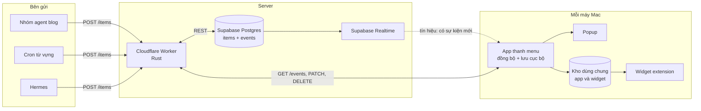
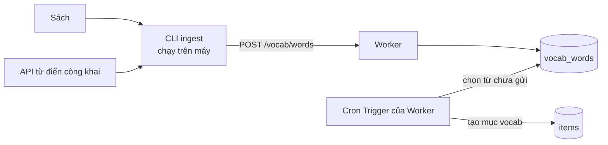
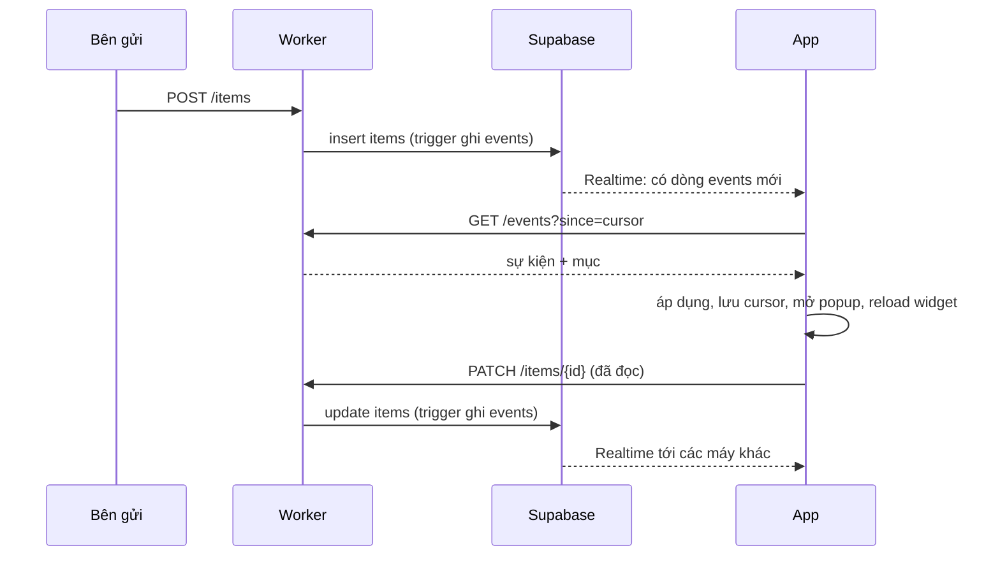

# Kiến trúc: os-widget

Cập nhật: 2026-11-27. Trạng thái: server (mục 3, 4.1 đến 4.3, 5 phía server) đã chạy trên bản deploy và qua nghiệm thu Giai đoạn 1, xem [roadmap.md](roadmap.md#giai-đoạn-1-server); app thanh menu và widget (mục 6) đã cài và qua nghiệm thu Giai đoạn 2 và 3; bộ từ vựng (mục 4.4, thẻ `vocab` và phát âm ở mục 6) đã chạy trên bản deploy và qua nghiệm thu Giai đoạn 4, xem [roadmap.md](roadmap.md#giai-đoạn-4-từ-vựng). Giai đoạn 0 có kết quả đo ở [roadmap.md](roadmap.md#giai-đoạn-0-kiểm-chứng). Các điểm còn ghi "chưa kiểm chứng" vẫn chờ giai đoạn 0 hoặc giai đoạn dùng tới chúng. Yêu cầu nằm ở [prd.md](prd.md).

## 1. Tổng quan

Hệ thống có ba phần: bên gửi, server và client. Server là nơi duy nhất giữ dữ liệu và trạng thái; client chỉ giữ bản sao cục bộ.



Hai nguyên tắc xuyên suốt:

- **Nội dung chỉ đi qua Worker.** Supabase Realtime chỉ báo "có gì mới", không mang nội dung.
- **Định dạng không phụ thuộc client.** Envelope mô tả ngữ nghĩa, không mô tả giao diện SwiftUI.

## 2. Quyết định chính

| Quyết định | Lựa chọn | Lý do |
|---|---|---|
| Client Apple | Swift, SwiftUI, AppKit cho thanh menu | Widget bắt buộc extension native; dùng lại được cho iPhone. |
| Popup | `NSStatusItem` + panel không kích hoạt | `MenuBarExtra` không có API chính thức để mở bằng code; popup không được cướp focus. |
| Widget | WidgetKit | Đúng bề mặt desktop của hệ thống; chấp nhận cập nhật có độ trễ. |
| Server | Cloudflare Worker viết bằng Rust | Lựa chọn của chủ dự án; kiểu Rust dùng làm lớp validate. |
| Kho dữ liệu | Supabase Postgres | Lựa chọn của chủ dự án; có sẵn Realtime. |
| Đẩy tức thì | Supabase Realtime làm tín hiệu | Worker không tự fan-out được giữa các request; tránh phải thêm Durable Object. |
| Đồng bộ | Nhật ký sự kiện có số thứ tự | Một cơ chế cho cả mục mới lẫn đã đọc và xoá; máy nào cũng bắt kịp được. |
| Định dạng | Envelope JSON riêng, `kind` định kiểu | Renderer Swift của Adaptive Cards yếu, A2UI còn Alpha và quá nặng; cả hai khó chạy trong widget. |

ntfy đã được cân nhắc làm server và bị loại vì không lưu được trạng thái đã đọc và xoá theo từng mục.

## 3. Envelope

### 3.1 Request publish

```json
{
  "v": 1,
  "kind": "vocab",
  "source": "vocab-cron",
  "priority": "normal",
  "title": "serendipity",
  "summary": "(n.) sự tình cờ may mắn",
  "url": null,
  "ttl": 86400,
  "dedupe_key": "vocab-2026-11-22T10",
  "body": { }
}
```

| Trường | Bắt buộc | Ý nghĩa |
|---|---|---|
| `v` | có | Phiên bản envelope. Hiện là 1. |
| `kind` | có | Loại nội dung, quyết định schema của `body` và view hiển thị. |
| `source` | có | Tên bên gửi, hiện trên thẻ. |
| `priority` | không | `low`, `normal` (mặc định) hoặc `high`. `low` không tự mở popup. |
| `title` | có | Text thuần, một dòng. |
| `summary` | có | Text thuần, ngắn. Cùng `title` là hiển thị dự phòng ở mọi nơi. |
| `url` | không | Liên kết mở khi bấm vào thẻ. Phải bắt đầu bằng `http://` hoặc `https://`. |
| `ttl` | không | Số giây tồn tại, ít nhất 1. Server đổi thành `expires_at`. Mặc định 7 ngày (604800 giây). |
| `dedupe_key` | không | Gửi lại cùng khoá không tạo mục mới. Không được rỗng. |
| `body` | tuỳ `kind` | Dữ liệu riêng của loại nội dung. |

Server sinh `id` (UUID) và `created_at`. Bên gửi không đặt hai trường này. `source`, `title`, `summary` không được rỗng hoặc chỉ có khoảng trắng, và `title` không được chứa xuống dòng. Mọi quy tắc nằm trong hàm `envelope::parse` (mục 4.2), dùng chung cho Worker và CLI.

### 3.2 Các loại `body`

**`notification`**: `{ "text": "markdown ngắn" }`. `body` có thể bỏ trống; khi đó thẻ chỉ gồm `title` và `summary`.

**`vocab`**:

```json
{
  "word": "serendipity",
  "ipa": "/ˌser.ənˈdɪp.ə.ti/",
  "pos": "noun",
  "audio_url": null,
  "meanings": [
    { "definition": "…", "examples": ["…"] }
  ],
  "context": "…",
  "synonyms": ["chance", "fluke"],
  "antonyms": ["misfortune"]
}
```

Bắt buộc: `word` (không rỗng, một dòng vì nó thành `title` của thẻ), `ipa` và `pos` (không rỗng, không chỉ có khoảng trắng), `meanings` (ít nhất một nghĩa, mỗi nghĩa có `definition` không rỗng). Tuỳ chọn: `audio_url` (HTTPS), `context`, `examples` trong mỗi nghĩa, `synonyms`, `antonyms`. Các quy tắc này nằm trong `envelope::check_vocab`, dùng chung cho `POST /items`, `POST /vocab/words` và lệnh `ingest`.

**`generic`**: `{ "blocks": [ … ] }`, mỗi block có trường `type`.

| Block | Trường | Tương ứng Adaptive Cards |
|---|---|---|
| `heading` | `text` | TextBlock cỡ lớn |
| `text` | `markdown` | TextBlock |
| `fields` | `items: [{label, value}]` | FactSet |
| `list` | `items: [string]`, `ordered` | TextBlock dạng danh sách |
| `image` | `url`, `alt` | Image |
| `code` | `text`, `language` | TextBlock đơn cách |
| `link` | `label`, `url` | Action.OpenUrl |

Tập block được giữ nhỏ có chủ ý để client Windows sau này ánh xạ được sang Adaptive Cards.

Quy tắc URL: `url` của envelope và `url` của block `link` phải bắt đầu bằng `http://` hoặc `https://`; `url` của block `image` và `audio_url` của `vocab` phải bắt đầu bằng `https://`, vì ảnh và âm thanh được tải tự động.

### 3.3 Quy tắc tiến hoá

- Client gặp `kind` lạ thì hiển thị `title` và `summary`. Client gặp block lạ thì bỏ qua block đó.
- Thêm trường tuỳ chọn không đổi `v`. Đổi nghĩa hoặc bỏ trường thì tăng `v`.
- Thêm một `kind` gồm ba việc: thêm biến thể vào kiểu Rust dùng chung, thêm kiểu `Codable` và view ở client, thêm bố cục rút gọn cho widget nếu cần.

## 4. Server

### 4.1 API của Worker

| Endpoint | Token | Vai trò |
|---|---|---|
| `POST /items` | publish | Validate envelope, lưu mục. Trả về `{"id": "..."}`: 201 khi tạo mục mới; 200 với `id` của mục đã có khi cùng `dedupe_key` đã được lưu (kể cả khi mục đó đã bị xoá, hoặc đã hết hạn nhưng chưa bị job dọn dẹp hằng ngày lúc 03:17 UTC xoá hẳn), và không sinh sự kiện mới. Vì vậy một khoá cố định đi với `ttl` ngắn có thể nhận 200 mà không có mục nào hiện ra cho tới lần dọn tiếp theo. |
| `GET /items` | client | `{"seq": <n>, "items": [...]}`: các mục chưa xoá và chưa hết hạn, mới nhất trước, cùng `seq` mới nhất đọc trước danh sách. Dùng cho lần đồng bộ đầu và để đối chiếu định kỳ. |
| `GET /events?since=<seq>&limit=<n>` | client | Các sự kiện có `seq` lớn hơn `since`, theo thứ tự tăng dần. `since` bắt buộc, số nguyên ≥ 0. `limit` mặc định 100, giá trị lớn hơn bị hạ về 100, giá trị nhỏ hơn 1 hoặc không phải số nguyên trả 400. Client gọi tiếp với `seq` cuối cùng khi nhận đủ một trang. Sự kiện `item.created` kèm toàn bộ mục trong trường `item`. |
| `PATCH /items/{id}` | client | Body `{"read": true}` hoặc `{"read": false}`; body khác trả 400. 204 khi mục ở đúng trạng thái yêu cầu (gửi lại không sinh sự kiện mới); 404 khi mục không tồn tại hoặc đã bị xoá. |
| `DELETE /items/{id}` | client | Xoá mềm. 204 khi mục tồn tại, dù vừa xoá hay đã xoá trước đó (xoá lại không sinh sự kiện); 404 khi không có mục đó. |
| `POST /vocab/words` | publish | Nạp một lô từ vào `vocab_words` (mục 4.4). Body `{"origin": "<tên sách hoặc API, 1–200 ký tự>", "words": [<body vocab>, …]}` với 1 đến 50 từ; mỗi từ phải qua `envelope::parse_vocab`. Trả 200 `{"stored": <số từ khác nhau đã ghi>}`. Một từ sai thì cả lô không ghi từ nào và trả 400 `{"error": "invalid vocab", "field": "words[3].ipa", "message": "…"}`. |

Token đặt trong header `Authorization: Bearer`. Có hai token tách riêng, lưu dưới dạng secret `PUBLISH_TOKEN` và `CLIENT_TOKEN` của Worker: token publish chỉ gọi được `POST /items` và `POST /vocab/words`, token client gọi được mọi endpoint còn lại. Thiếu header hoặc token không khớp token nào trả 401; đúng một token nhưng sai loại cho endpoint trả 403. Token được kiểm trước khi định tuyến, nên người không có token không dò được đường dẫn nào tồn tại. Lộ token publish không cho phép đọc nội dung.

Lỗi trả JSON `{"error": "<mã>"}`. Envelope sai trả 400 với `{"error": "invalid envelope", "field": "<đường dẫn>", "message": "<lý do>"}`, ví dụ `field` là `body.meanings[0]` khi nghĩa đầu tiên thiếu `definition`; `field` rỗng khi lỗi nằm ở gốc envelope, chẳng hạn thiếu `title`, và khi đó `message` nêu tên trường. `id` không phải UUID trả 404 mà không chạm tới Supabase. Supabase lỗi trả 502.

Client coi 404 của `PATCH` và `DELETE` là thao tác đã xong: mục đã bị xoá ở nơi khác hoặc đã bị dọn hẳn, nên hàng đợi gửi đi bỏ thao tác đó.

### 4.2 Bố cục mã Rust

Một Cargo workspace gồm ba crate:

- `envelope`: các kiểu dữ liệu của envelope, trong đó `body` là enum gắn thẻ theo `kind`. Đây là nguồn chân lý duy nhất của định dạng; một envelope hợp lệ khi `envelope::parse` chấp nhận nó (xem bên dưới).
- `worker`: các handler HTTP, dùng `workers-rs`, gọi Supabase qua REST.
- `cli`: binary `os-widget` cho agent và cron. Lệnh `os-widget publish` dựng envelope `notification` từ cờ (`--source`, `--title`, `--summary`, `--text`, `--link`, `--priority`, `--ttl`, `--dedupe-key`) hoặc đọc envelope đầy đủ từ `--file` (hoặc stdin với `-`), validate bằng `envelope::parse` trước khi gửi, rồi in `id`. URL server lấy từ `OS_WIDGET_SERVER` hoặc `--server`; token chỉ lấy từ `OS_WIDGET_PUBLISH_TOKEN`, không nhận qua cờ. Mã thoát 2 khi envelope sai, 1 với mọi lỗi khác.

Crate `envelope` có hàm `envelope::parse`, nhận byte JSON và trả envelope hoặc lỗi kèm `field` và `message`. Worker và CLI cùng gọi hàm này, nên hai bên áp đúng một bộ quy tắc.

Worker gọi Supabase bằng REST (PostgREST) với khoá service role lưu dưới dạng secret. Đây là đường ít rủi ro nhất từ Wasm; giai đoạn 0 đã chạy được đường này bằng `worker::Fetch`. Kết nối Postgres trực tiếp qua Hyperdrive là phương án thay thế nếu REST không đáp ứng; chưa kiểm chứng với `workers-rs`.

### 4.3 Cơ sở dữ liệu

```sql
create table items (
  id          text primary key,
  kind        text not null,
  source      text not null,
  priority    text not null default 'normal',
  title       text not null,
  summary     text not null,
  url         text,
  body        jsonb,
  dedupe_key  text unique,
  created_at  timestamptz not null default now(),
  expires_at  timestamptz,
  read_at     timestamptz,
  deleted_at  timestamptz
);

create table events (
  seq        bigint generated always as identity primary key,
  type       text not null,        -- item.created | item.read | item.unread | item.deleted
  item_id    text not null,
  created_at timestamptz not null default now()
);
```

- Một trigger trên `items` ghi một dòng vào `events` cho mỗi lần thêm, đổi `read_at` hoặc đặt `deleted_at`. Sự kiện và dữ liệu nằm trong cùng transaction, nên nhật ký không lệch khỏi dữ liệu.
- Xoá là xoá mềm (`deleted_at`). Client tự ẩn mục hết hạn theo `expires_at`, nên hết hạn không cần sự kiện.
- Hàm `purge_old_rows()` chạy mỗi ngày lúc 03:17 UTC bằng `pg_cron` ngay trong Supabase, không tốn CPU của Worker và không dùng Cron Trigger. Hàm xoá hẳn mục đã hết hạn, mục đã xoá mềm quá 30 ngày và sự kiện cũ hơn 30 ngày. Thời gian giữ 30 ngày bằng nhau cho mục đã xoá và sự kiện, nên client bắt kịp trong vòng 30 ngày vẫn thấy `item.deleted` trước khi mục biến mất; thời gian giữ độc lập với `ttl`. Không role nào ngoài chủ hàm và tác vụ cron được gọi hàm này, nên khoá anon không gọi được `rpc/purge_old_rows`.
- `item.created` của một mục đã bị dọn hẳn vẫn còn trong nhật ký tới khi chính sự kiện đó bị dọn; khi đó `GET /events` trả `"item": null` và client bỏ qua sự kiện.
- Bảng `events` nằm trong publication của Supabase Realtime. Bảng này chỉ chứa `seq`, `type`, `item_id`, không chứa nội dung, nên khoá anon nhúng trong app chỉ được đọc riêng bảng này. Quyền đóng ở hai lớp: quyền bảng (bỏ mọi quyền mặc định của `anon` và `authenticated`, chỉ cấp lại `select` trên `events` cho `anon`) và RLS (một chính sách cho `anon` đọc `events`). Một chính sách thiếu hay sai vì vậy không tự làm lộ dữ liệu. Bảng `items` không cấp quyền nào cho khoá anon; chỉ khoá service role của Worker đọc và ghi bảng này. Project đã tắt khoá anon kiểu JWT cũ; app dùng khoá publishable (`sb_publishable_...`).

### 4.4 Bộ từ vựng

Bộ từ là một bên gửi nội bộ: nó tạo mục `vocab` qua cùng đường với mọi bên gửi khác, nên client không cần biết gì về nó.



```sql
create table vocab_words (
  word        text primary key,
  entry       jsonb not null,       -- đúng schema body của kind vocab
  origin      text not null,        -- tên sách hoặc tên API
  added_at    timestamptz not null default now(),
  sent_at     timestamptz
);

create table settings (
  key   text primary key,
  value jsonb not null              -- các khoá vocab_* ở bảng dưới
);
```

Schema nằm ở `supabase/migrations/20261124000000_vocab.sql`. Hai bảng không cấp quyền nào cho `anon` và `authenticated` và bật RLS không có chính sách; hai hàm `vocab_upsert` và `vocab_tick` chỉ `service_role` (Worker) gọi được.

| Khoá `settings` | Giá trị đã chốt | Ý nghĩa |
|---|---|---|
| `vocab_enabled` | `true` | Tắt thì cron trả `disabled`. |
| `vocab_interval_minutes` | `60` | Chu kỳ gửi, 1 phút đến 10 năm. |
| `vocab_when_exhausted` | `"rotate"` | `"rotate"` (quay vòng) hoặc `"stop"` khi mọi từ đã gửi. |
| `vocab_priority` | `"normal"` | `priority` của mục `vocab`; `normal` làm popup tự mở. |
| `vocab_item_ttl_seconds` | `86400` | `ttl` của mục `vocab` (1 ngày), 1 giây đến 1 năm. |
| `vocab_last_sent_at` | do `vocab_tick` ghi | Thời điểm gửi gần nhất. |

Giá trị sai kiểu hoặc ngoài khoảng không làm hàm lỗi: hàm dùng giá trị mặc định ở bảng trên và ghi tên khoá vào `warnings` của kết quả.

- **Nạp chạy trên máy, không chạy trong Worker.** Tách từ khỏi sách và gọi API từ điển để lấy phiên âm, nghĩa, ví dụ là việc nặng và chậm, vượt hạn mức 10 ms CPU. Lệnh `os-widget ingest` là một lệnh con của crate `cli`, dựng body bằng kiểu `vocab` của crate `envelope` và kiểm bằng `envelope::check_vocab`, nên mục sai định dạng bị loại trước khi lên server. Từ bị bỏ được in ra màn hình kèm lý do. Lệnh gửi theo lô 25 từ tới `POST /vocab/words` bằng token publish; lô trước đã ghi thì vẫn còn khi lô sau lỗi, và nạp lại là an toàn.
- **`os-widget ingest words`** tra từng từ ở Free Dictionary API (`https://api.dictionaryapi.dev/api/v2/entries/en`, miễn phí, không cần khoá), tuần tự, cách nhau ít nhất 300 ms, thử lại 429 và 5xx tối đa 3 lần. Ánh xạ: `ipa` là `phonetic`, nếu rỗng thì `phonetics[].text` đầu tiên khác rỗng; nhóm nghĩa có nhiều định nghĩa nhất cho `pos` và tối đa 3 `meanings` (mỗi nghĩa kèm `example` nếu có); `synonyms` và `antonyms` lấy từ nhóm đó trước rồi các nhóm khác, không trùng, tối đa 6; `audio_url` là audio đầu tiên khác rỗng, ưu tiên bản US, chỉ giữ HTTPS. API không có câu ngữ cảnh. Đo trên 20 từ: đủ trường bắt buộc 17/20; có ví dụ 9/20, đồng nghĩa 14/20, trái nghĩa 8/20, audio 15/20 ([báo cáo độ phủ](../plans/261124-1415-m4-vocab/reports/api-coverage.md)).
- **`os-widget ingest book <file.txt>`** đọc sách văn bản thuần UTF-8. Với bản Project Gutenberg, chỉ lấy phần giữa hai dòng `*** START OF` và `*** END OF`. Chọn tối đa `--max` từ (mặc định 50) dài ít nhất `--min-length` chữ cái (mặc định 5), theo thứ tự xuất hiện đầu tiên: không phải từ chức năng, không thuộc 300 từ gặp nhiều nhất của sách (và không quá một phần mười số từ khác nhau), gặp ít nhất 2 lần và ít nhất một lần viết thường (loại tên riêng), có một câu dài 20 ký tự trở lên để trích. `context` là câu đầu tiên chứa từ viết thường, cắt quanh từ khi dài hơn 240 ký tự. Từ chọn được rồi đi qua cùng bước tra API và gửi theo lô như `ingest words`. Lời tựa nằm trong phần giữa hai dòng mốc, nên sách có lời tựa dài phải cắt tay trước khi nạp. EPUB và PDF chưa làm.
- **`vocab_upsert(origin, words)`.** Khoá chính là `word` viết thường và bỏ khoảng trắng hai đầu, nên nạp lại không tạo bản trùng; trong một lô, lần xuất hiện cuối thắng. Nạp lại một từ đã có ghi đè `entry` và `origin`, giữ `added_at` và `sent_at` (từ vừa nạp lại không bị gửi sớm). Riêng `context`: nếu bản mới không có mà bản cũ có thì giữ bản cũ, để nạp từ API sau khi nạp từ sách không làm mất câu trong sách.
- **Gửi theo chu kỳ bằng Cron Trigger của Worker** `*/5 * * * *` (một trigger, khai báo trong `crates/worker/wrangler.toml`). Mỗi lần chạy, Worker chỉ gọi `POST /rest/v1/rpc/vocab_tick` và ghi một dòng log `vocab.tick status=<status>` (không ghi từ). Mọi logic nằm trong hàm SQL `vocab_tick()`, chạy trong một transaction:
  1. Lấy khoá advisory, nên hai lần chạy chồng nhau không gửi trùng.
  2. Đọc các khoá `vocab_*` của `settings`. `vocab_enabled` là `false` thì trả `disabled`.
  3. Chưa tới hạn thì trả `not_due`. Tới hạn khi `now() >= vocab_last_sent_at + vocab_interval_minutes - 1 phút`; phút trừ đi bù cho độ lệch giữa các lần chạy cron.
  4. Chọn ngẫu nhiên một từ chưa gửi (`sent_at` rỗng). Không còn từ nào: bảng rỗng thì trả `empty`; `vocab_when_exhausted` là `"stop"` thì trả `exhausted`; `"rotate"` thì xoá `sent_at` của mọi từ rồi chọn lại, trừ từ vừa gửi gần nhất (khi bảng có hơn một từ).
  5. Tạo một mục `items`: `kind` `vocab`, `source` `vocab-cron`, `priority` theo `vocab_priority`, `title` là từ, `summary` là `(<pos>) ` cộng 140 ký tự đầu của nghĩa đầu, `body` là `entry`, `dedupe_key` `vocab:<word>:<phút UTC>`, `expires_at` theo `vocab_item_ttl_seconds`. Trigger có sẵn trên `items` ghi `item.created`, nên client nhận mục `vocab` như mọi mục khác. Khoá `dedupe_key` đã có thì trả `duplicate`.
  6. Ghi `sent_at` của từ và `vocab_last_sent_at`, trả `sent` kèm `word`, `item_id`, `rotated`.

  Đổi chu kỳ, mức ưu tiên hay cách xử lý khi hết từ vì vậy là sửa một dòng `settings`, có hiệu lực ở lần chạy cron kế tiếp, không phải deploy lại. Đã kiểm trên live: chu kỳ 5 phút cho các thẻ cách nhau 300–301 giây, 15 phút cho 899 giây; bộ 62 từ quay vòng hai lần trong một đêm, không gửi lại ngay từ vừa gửi và không có mục rỗng ([nghiệm thu server](../plans/261124-1415-m4-vocab/reports/acceptance-server.md)).

Hạn mức Cron Trigger ở gói miễn phí: tối đa 5 Cron Trigger mỗi tài khoản, 10 ms CPU mỗi lần chạy, nhịp nhỏ nhất 1 phút. Cron của bộ từ chỉ dùng một trigger. CPU đo được ở mục 8: một số lần chạy vượt 10 ms (isolate lạnh) mà vẫn `ok`. Nếu Cloudflare bắt đầu chặn lần chạy cron vì CPU, cùng hàm `vocab_tick()` được lên lịch bằng `pg_cron` (như `purge_old_rows`) và gỡ Cron Trigger, không phải sửa mã Worker.

## 5. Giao thức đồng bộ



- **Cursor** là `seq` của sự kiện cuối cùng client đã áp dụng, lưu bền trên máy.
- **Khi nào fetch.** Khi nhận tín hiệu Realtime, khi Realtime kết nối lại, khi máy thức dậy, khi mạng trở lại, và theo chu kỳ poll dự phòng. Supabase không phát lại sự kiện Realtime bị lỡ, nên tín hiệu chỉ là gợi ý; nguồn chân lý là `GET /events`.
- **Áp dụng sự kiện là idempotent.** Áp dụng lại một sự kiện không đổi kết quả. Client vì vậy có thể fetch chồng lấn mà không sinh mục trùng.
- **Khe hở thứ tự.** Hai transaction ghi đồng thời có thể commit không theo thứ tự `seq`, khiến client bỏ sót một sự kiện. Lưu lượng ghi của hệ thống này rất thấp nên hiếm gặp; để chắc chắn, client fetch lùi cursor một khoảng nhỏ và đối chiếu định kỳ với `GET /items`.
- **Máy ngoại tuyến lâu.** Sự kiện chỉ được giữ 30 ngày (mục 4.3). Máy ngoại tuyến lâu hơn sẽ thiếu sự kiện ở đầu nhật ký, nên phải dựa vào đối chiếu với `GET /items` để bỏ các mục đã bị xoá hoặc đã bị dọn, rồi tiếp tục từ `seq` mà `GET /items` trả về.
- **Thao tác của người dùng.** Đã đọc và xoá được áp dụng ngay vào kho cục bộ, đồng thời đưa vào một hàng đợi gửi đi. Hàng đợi được gửi lại cho tới khi thành công. Cả hai thao tác đều idempotent; xoá thắng đã đọc.

## 6. Client macOS

Một app và một widget extension, cùng một Xcode project.

| Thành phần | Trách nhiệm |
|---|---|
| Sync engine | Giữ kết nối Realtime, fetch sự kiện, poll dự phòng, giữ cursor, gửi hàng đợi thao tác. |
| Kho cục bộ | Danh sách mục và trạng thái, lưu trong vùng dùng chung giữa app và widget. |
| Status item | Icon thanh menu, dấu báo chưa đọc, mở danh sách khi bấm. |
| Popup | Một panel duy nhất dưới icon cho mục mới, tự đóng sau 30 giây, dừng đếm khi chuột ở trong. Quyết định có mở hay không dựa trên `priority`, cài đặt theo từng `kind`, chế độ yên lặng và việc danh sách có đang mở. |
| Card renderer | Bảng ánh xạ `kind` sang view; `generic` render theo block; loại lạ render dự phòng. |
| Widget extension | Đọc kho dùng chung, hiện các mục mới nhất, nút đã đọc và xoá qua AppIntent. |

Chi tiết đáng lưu ý:

- **App là tiến trình duy nhất gọi mạng.** Widget không gọi server. App ghi kho dùng chung rồi yêu cầu WidgetKit làm mới, và chỉ yêu cầu khi nội dung widget thực sự đổi để tiết kiệm hạn mức làm mới.
- **Nút trong widget** cập nhật kho dùng chung và thêm vào hàng đợi; app gửi hàng đợi lên server.
- **Phát âm** phát `audio_url` nếu có, không thì đọc `word` bằng bộ đọc của hệ thống (`AVSpeechSynthesizer`). Chỉ đặt nút phát âm ở popup và danh sách; phát âm thanh từ widget có nhiều báo cáo lỗi. Đã làm ở Giai đoạn 4, xem "Thẻ từ vựng đã làm (Giai đoạn 4)" bên dưới.
- **Chạy khi đăng nhập** bằng `SMAppService`. App là agent (`LSUIElement`), không có icon Dock.
- **Mã dùng chung** (kiểu envelope, kho, view thẻ) tách thành một Swift package cục bộ để widget, app và bản iPhone sau này dùng lại.

### App thanh menu đã làm (Giai đoạn 2)

- **Vị trí mã.** `apps/macos/`: project sinh bằng XcodeGen từ `project.yml` (không commit `.xcodeproj`), target app `OSWidget` (bundle `local.oswidget.app`) trong `App/`, và Swift package cục bộ `OSWidgetKit` chứa cấu hình, mô hình, kho, sync engine, view thẻ và chính sách popup để widget và bản iPhone sau này dùng lại. Package không có phụ thuộc ngoài.
- **Ký và quyền.** Personal Team `22LZWPB3XL`, đặt một lần ở `DEVELOPMENT_TEAM` trong `project.yml`. App Sandbox, `network.client`, App Group `22LZWPB3XL.os-widget` (suy ra từ Team ID). Cài bằng build Release với `-allowProvisioningUpdates` rồi copy vào `/Applications`; chạy khi đăng nhập bằng `SMAppService` (app tự đăng ký ở lần chạy đầu).
- **Cấu hình.** URL Worker, URL Supabase và khoá publishable lưu trong `UserDefaults` của app; token client lưu trong Keychain (service `local.oswidget.app`). Nhập ở cửa sổ "Cài đặt…".
- **Kho cục bộ.** Một file `store.json` trong group container `22LZWPB3XL.os-widget` (`StoreLocation.appGroup`), ghi lại sau mỗi thay đổi: mục, cursor, hàng đợi thao tác, cài đặt popup, lần đối chiếu cuối. Tên file riêng nên không đụng dữ liệu của app thử nghiệm A dùng chung container. Chỉ app ghi `store.json`; widget không ghi kho mà để thao tác vào hộp thư riêng (xem "Widget đã làm (Giai đoạn 3)" bên dưới), nên không cần phối hợp ghi giữa hai tiến trình. Vị trí này theo nhánh "A đạt"; kết quả kiểm ngày 8 của thử nghiệm A (2026-11-30) còn chờ và có thể đổi nhánh (xem §9).
- **Realtime.** Client kênh Phoenix tự viết trên `URLSessionWebSocketTask` (không dùng `supabase-swift`), join `postgres_changes` `INSERT` trên `events` bằng khoá publishable. Tín hiệu chỉ kích hoạt một vòng sync, không mang dữ liệu. Heartbeat 25 giây; mất kết nối thì nối lại với thời gian chờ tăng dần từ 1 giây tới tối đa 60 giây.
- **Vòng sync.** Gửi hàng đợi trước, rồi `GET /events` từ `cursor - 20` theo trang 100 (lùi 20 để bắt sự kiện commit muộn; áp dụng lại là idempotent), rồi đối chiếu đầy đủ bằng `GET /items` khi lần trước đã quá 6 giờ hoặc cursor không hợp lệ. Kích hoạt bởi tín hiệu Realtime, poll mỗi 5 phút, mạng có lại (`NWPathMonitor`), máy thức dậy, thao tác mới trong hàng đợi và đổi cấu hình.
- **Hàng đợi thao tác.** Đã đọc và xoá áp dụng ngay vào kho rồi xếp hàng. 2xx và 404 là xong (404: mục đã bị xoá ở nơi khác hoặc đã dọn); 408, 429, 5xx và lỗi mạng thử lại sau; 401 và 403 dừng gửi, giữ hàng đợi tới khi đổi token; mã 4xx khác bỏ thao tác. Mục đã xoá không nhận thao tác nào nữa.
- **Popup.** `NSPanel` `.nonactivatingPanel` mở bằng `orderFrontRegardless()`, không thành key window (cấu hình của thử nghiệm C). Log `popup.shown id=… others=… latency_ms=…` tính từ `created_at` của mục; lý do không hiện ghi `popup.suppressed reason=…`.
- **Log.** `os.Logger` subsystem `local.oswidget.app` (category `sync`, `store`, `popup`, `login`, `model`, và `audio` từ Giai đoạn 4), chỉ ghi id, `seq`, mã trạng thái và trạng thái, không ghi token hay nội dung mục.

### Widget đã làm (Giai đoạn 3)

- **Target.** `OSWidgetWidget` (extension `com.apple.widgetkit-extension`, bundle `local.oswidget.app.widget`) trong `apps/macos/Widget/`, nhúng vào app `OSWidget` và khai báo trong `apps/macos/project.yml`. Một widget `OSWidgetItems` (`WidgetKind.items`, tên hiển thị "OS Widget") cỡ vừa và cỡ lớn. Entitlement: App Sandbox và cùng App Group `22LZWPB3XL.os-widget`, không có `network.client`.
- **Nội dung.** Widget đọc `store.json` trong group container, hiện mục mới nhất trên cùng: 3 mục ở cỡ vừa, 6 mục ở cỡ lớn (`WidgetSize` trong `OSWidgetKit`), đầu widget có số chưa đọc. Mỗi `kind` có bố cục rút gọn (`CompactCardView`); loại chưa có bố cục hiện `title` và `summary`. Bố cục rút gọn của `vocab` có từ Giai đoạn 4. Mục đã đọc làm mờ và mất dấu tích. Bấm vào thân mục không làm gì.
- **Hộp thư thao tác.** Nút đã đọc và xoá là `MarkItemReadIntent` và `DeleteItemIntent` (`apps/macos/Widget/ItemIntents.swift`). Intent ghi mỗi thao tác thành một file `<uuid>.json` trong thư mục `inbox` cạnh `store.json` (ghi vào file `.tmp-` rồi đổi tên, nên nhiều bên ghi và app đọc cùng lúc không cần khoá); xem `ActionInbox` trong `OSWidgetKit`. Chỉ app xoá file, sau khi áp dụng vào kho. `InboxWatcher` (`apps/macos/App/Widget/`) theo dõi thư mục và rút hộp thư (`ItemStore.drain`), rồi thao tác đi vào hàng đợi gửi lên server như thao tác trong app. Nhờ vậy widget cập nhật ngay cả khi app đã thoát (đo được: `unread` trong timeline đổi sau khoảng 30 ms) và thao tác được gửi khi app chạy lại.
- **Chính sách reload.** `WidgetReloadPolicy` (`OSWidgetKit`) và `WidgetReloader` (`apps/macos/App/Widget/`): app chỉ gọi `reloadTimelines(ofKind:)` khi ảnh chụp nội dung widget (có cả thao tác đang chờ trong hộp thư) khác lần trước, không quá một lần mỗi 5 giây. Thay đổi tới quá sớm được giữ lại và trả lời bằng một reload sau khi đủ 5 giây với ảnh chụp mới nhất. Vòng sync không đổi gì không gây reload. Mỗi lần bấm nút gây khoảng 2 reload (một ngay sau khi rút hộp thư, một sau khoảng 5 giây khi sync áp lại trạng thái từ server).
- **Log đếm.** Subsystem `local.oswidget.app`, category `widget`, mức `notice`: `widget.reload n_today=<n> reason=<first|changed|trailing> gap_ms=<ms>` mỗi yêu cầu của app, `widget.timeline family=… items=… unread=… top=…` mỗi lần widget dựng timeline, `widget.intent action=<read|delete> id=…` và `widget.inbox_drained count=…`. `n_today` về 0 lúc nửa đêm theo giờ máy và khi app chạy lại (dòng đầu sau đó ghi `n_today=1`), nên đếm bằng `scripts/widget-reload-count.sh`, không dùng `n_today`. Log không ghi token hay nội dung mục. `log show` không giữ dòng `info` và có khoảng trống khi máy ngủ, nên đếm một ngày dùng `log stream` ghi ra file ngoài repo, lọc theo tiến trình `OSWidget*` (`swift test` ghi cùng subsystem).
- **Nghiệm thu.** `scripts/acceptance-widget.sh` (`2`, `read`, `delete`, `offline`, `reload`, `checklist`, `day`, `all`); đầu ra ở [báo cáo nghiệm thu](../plans/261124-1415-m3-widget/reports/acceptance.md) và [đếm một ngày](../plans/261124-1415-m3-widget/reports/reload-day.md).

### Thẻ từ vựng đã làm (Giai đoạn 4)

- **Thẻ đầy đủ.** `VocabCardView` (`OSWidgetKit`, `Cards/`) dùng cho popup và danh sách: dòng đầu là từ, phiên âm, từ loại và nút phát âm (phiên âm và từ loại xuống dòng thứ hai khi từ dài); rồi tối đa 3 nghĩa đánh số, mỗi nghĩa tối đa 1 ví dụ; câu ngữ cảnh; "Đồng nghĩa" và "Trái nghĩa" (ẩn khi rỗng); nguồn và thời gian. Mọi chữ hiện nguyên văn, không đọc như markdown hay HTML. Kiểu dữ liệu là `VocabContent` (`ItemContent.vocab`).
- **Phát âm.** `Pronouncer` (`Cards/Pronunciation.swift`) chỉ phát khi người dùng bấm nút (FR-7), và bấm nút không đánh dấu đã đọc. Có `audio_url` mà `URLPolicy` cho tải (HTTPS, có host) thì phát bằng `AVPlayer`; không thì đọc từ bằng `AVSpeechSynthesizer`. File không tải được, lỗi khi phát hoặc sau 5 giây chưa phát thì chuyển sang bộ đọc. Mỗi lúc chỉ phát một từ. Log category `audio`: `pronounce.play source=audio|speech` và `pronounce.fallback reason=load|play|timeout`, không ghi từ hay URL.
- **Widget.** `CompactVocabView` (`Cards/Compact/`): dòng từ, phiên âm và từ loại, rồi nghĩa đầu (tối đa 2 dòng); còn dòng thì thêm ví dụ đầu, tối đa 3 từ đồng nghĩa và câu ngữ cảnh (tối đa 2 dòng). Không có nút phát âm.
- **Nghiệm thu.** PRD §10.5 với thẻ do cron gửi và thẻ publish tay, ở [báo cáo nghiệm thu](../plans/261124-1415-m4-vocab/reports/acceptance.md).

### Chia sẻ dữ liệu giữa app và widget

Phương án chính là App Group với định danh có tiền tố Team ID, dạng mà Apple mô tả là không cần đăng ký trên trang Developer. Thử nghiệm A ngày đầu cho thấy App Group dạng `<TeamID>.os-widget` dùng được giữa app và widget khi ký bằng Personal Team miễn phí, và Xcode không nhúng provisioning profile nào. Việc app còn chạy sau 7 ngày chờ lần kiểm ngày 8 ([roadmap.md](roadmap.md#giai-đoạn-0-kiểm-chứng)). Nếu không được, widget lấy ảnh chụp từ app qua HTTP trên localhost.

## 7. Bảo mật

| Tài sản | Bảo vệ |
|---|---|
| Nội dung các mục | Chỉ đọc được qua Worker với token client. |
| Quyền publish | Token publish riêng; lộ token này không lộ nội dung. |
| Khoá service role của Supabase | Chỉ nằm trong secret của Worker. |
| Khoá anon của Supabase trong app | Chỉ đọc được bảng `events` (số thứ tự và id). |
| Token client trên máy | Lưu trong Keychain. |

Nội dung do bên gửi cung cấp được coi là dữ liệu: markdown không được render HTML thô, liên kết chỉ mở khi người dùng bấm, ảnh chỉ tải qua HTTPS.

## 8. Hạn mức miễn phí

| Tài nguyên | Hạn mức | Mức dùng ước tính |
|---|---|---|
| Worker, request | 100.000 mỗi ngày | Vài trăm mỗi ngày |
| Worker, CPU | 10 ms mỗi request hoặc mỗi lần chạy cron | Đo trên Worker Rust đã deploy (hai lần, 140–147 request mỗi endpoint): `POST /items` p50 2 ms, p99 11 ms; `GET /events` (5 sự kiện mỗi lần) p50 3 ms, p99 7 ms. Request trúng isolate mới tốn 16–21 ms nhưng không bị chặn. Cron từ vựng (`wrangler tail`, 2026-11-24 và 26): lần chạy `empty` p50 9 ms, lớn nhất 17 ms (13 lần, 4 lần vượt 10 ms); lần chạy `sent` 9 và 17 ms (2 lần). `POST /vocab/words` (lô 1 đến 25 từ) p50 7 ms, lớn nhất 28 ms (6 request, 3 vượt 10 ms; phần vượt đến từ isolate lạnh, không từ cỡ lô). Mọi lần đều `ok`, không có `exceededCpu`. Thời gian chờ Supabase không tính. |
| Worker, dung lượng | 64 MiB chưa nén (không còn hạn mức sau nén) | 656.64 KiB chưa nén, 216.96 KiB sau gzip (bản Giai đoạn 1; bản Giai đoạn 0 là 563.08 KiB và 191.37 KiB). |
| Supabase Realtime, message | 2 triệu mỗi tháng | Khoảng 6.000 mỗi tháng |
| Supabase Realtime, kết nối | 200 đồng thời | 2 đến 3 |
| Worker, Cron Trigger | 5 mỗi tài khoản | 1 (`*/5 * * * *`, 288 lần chạy mỗi ngày, mỗi lần một RPC) |
| Supabase, project | Tạm dừng sau khoảng một tuần ít hoạt động | Cron từ vựng gọi Supabase 5 phút một lần, giữ project hoạt động |

Chu kỳ poll dự phòng phải đủ thưa để hai máy không tiêu đáng kể hạn mức request; vài phút một lần là dư.

## 9. Rủi ro kỹ thuật

| Rủi ro | Ảnh hưởng | Phương án |
|---|---|---|
| App Groups không dùng được với tài khoản miễn phí | Widget không đọc được dữ liệu | Ngày đầu thử nghiệm A đã dùng được; nếu hỏng về sau, widget lấy ảnh chụp qua localhost. |
| Profile ký hết hạn sau khoảng 7 ngày | Phải build lại định kỳ | App thanh menu cài ngày 2026-11-23 theo nhánh "A đạt": ký Personal Team, không script build lại. Kết quả kiểm ngày 8 của thử nghiệm A (2026-11-30) còn chờ. Nếu app không mở được sau khoảng 7 ngày: thêm `scripts/build-install-macos.sh` để build và cài lại hằng tuần bằng một lệnh (quyết định của chủ dự án); tài khoản trả phí để sau, khi đó chỉ đổi `DEVELOPMENT_TEAM` trong `apps/macos/project.yml`. |
| Widget làm mới chậm hoặc bị giới hạn | Widget hiện nội dung cũ | Popup là bề mặt tức thì; nếu quá chậm, thay widget bằng cửa sổ SwiftUI ở tầng desktop. Đã đo ngày 2026-11-24: trễ từ `sync.applied` tới `widget.timeline` 33–251 ms (5 lần nghiệm thu), từ yêu cầu reload tới timeline p50 39 ms, lớn nhất 122 ms (45 yêu cầu); khoảng cách nhỏ nhất giữa hai yêu cầu 5006 ms. Số reload trong 24 giờ đầu (15:28:48 ngày 24/11 tới cùng giờ ngày 25/11) là 45, trên ngưỡng 40 của chủ dự án, nhưng cả 45 thuộc lúc nghiệm thu. Đếm lại 12 giờ dùng thật ngày 2026-11-27 (08:56:41 tới 20:56:41, thẻ vocab mỗi giờ, ngưỡng 20 của chủ dự án): 12 yêu cầu (10 do thẻ mới, 2 do một thao tác đã đọc), khoảng cách nhỏ nhất 5290 ms, 100% có timeline trong 5 s (lớn nhất 178 ms): đạt; không thấy hệ thống từ chối hay trễ reload. Mỗi thao tác đã đọc hay xoá gây khoảng 2 reload. Máy ngủ không gây reload thừa; đêm 26–27/11 (thẻ mỗi 5 phút) app sync ở các lần thức tối và gộp 130 thẻ thành 43 reload, và sau khi thức vòng sync đầu áp thẻ mới với đúng một reload. Ngân sách tối đa khi app ở nền vẫn chưa bị chạm tới. |
| Popup cướp focus | Gián đoạn khi đang gõ | Dùng panel không kích hoạt thay cho popover; thử nghiệm C ngày đầu xác nhận panel này không lấy focus khỏi app đang gõ. |
| Worker Rust vượt 10 ms CPU | Request bị Cloudflare chặn ở gói miễn phí | Đã đo ở giai đoạn 0: trượt ngưỡng p99 ≤ 5 ms đặt ra (`POST /items` 11 ms, `GET /events` 7 ms); chủ dự án vẫn giữ Rust và chấp nhận rủi ro. Khi đã ấm, p50 chỉ 2–3 ms; đuôi p99 đến từ request trúng isolate mới đang khởi động Wasm, và các request đó tốn 16–21 ms, vượt hạn mức 10 ms nhưng lần đo không request nào bị chặn. `GET /events?since=0` với 159 sự kiện tốn 15–19 ms, nên Giai đoạn 1 thêm giới hạn số sự kiện mỗi trang. Nếu Cloudflare bắt đầu chặn: viết lại Worker bằng TypeScript, giữ nguyên API và schema. |
| Supabase tạm dừng project | Mất đồng bộ cho tới khi bật lại | Cron giữ hoạt động; app báo rõ khi server không phản hồi. |

## 10. Mở rộng sang nền tảng khác

- **iPhone.** Dùng lại Swift package dùng chung và widget. App iPhone không chạy nền liên tục, nên cần thêm một đường push của Apple ở phía server; đây là phần mới duy nhất về giao thức.
- **Windows.** Client viết riêng (C# với WinUI 3, hoặc Tauri) dùng cùng API. Widget Windows 11 cần một widget provider chuyển envelope thành Adaptive Cards. Kiểu envelope bằng Rust có thể dùng lại nếu client viết bằng Rust.
