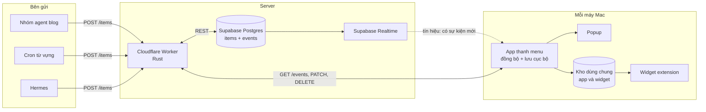
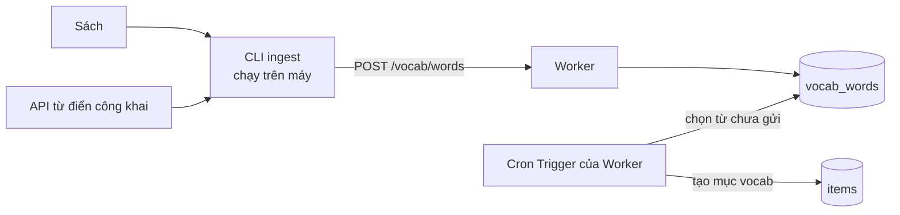
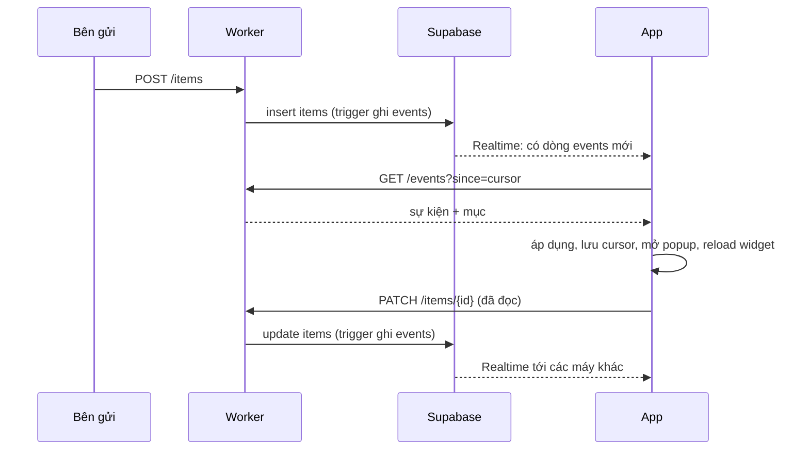

# Kiến trúc: os-widget

Cập nhật: 2026-11-22. Trạng thái: thiết kế; giai đoạn 0 đã có khung Worker Rust thử nghiệm và kết quả đo, xem [roadmap.md](roadmap.md#giai-đoạn-0-kiểm-chứng). Các điểm còn ghi "chưa kiểm chứng" vẫn chờ giai đoạn 0 hoặc giai đoạn dùng tới chúng. Yêu cầu nằm ở [prd.md](prd.md).

## 1. Tổng quan

Hệ thống có ba phần: bên gửi, server và client. Server là nơi duy nhất giữ dữ liệu và trạng thái; client chỉ giữ bản sao cục bộ.



Hai nguyên tắc xuyên suốt:

- **Nội dung chỉ đi qua Worker.** Supabase Realtime chỉ báo "có gì mới", không mang nội dung.
- **Định dạng không phụ thuộc client.** Envelope mô tả ngữ nghĩa, không mô tả giao diện SwiftUI.

## 2. Quyết định chính

| Quyết định | Lựa chọn | Lý do |
|---|---|---|
| Client Apple | Swift, SwiftUI, AppKit cho thanh menu | Widget bắt buộc extension native; dùng lại được cho iPhone. |
| Popup | `NSStatusItem` + panel không kích hoạt | `MenuBarExtra` không có API chính thức để mở bằng code; popup không được cướp focus. |
| Widget | WidgetKit | Đúng bề mặt desktop của hệ thống; chấp nhận cập nhật có độ trễ. |
| Server | Cloudflare Worker viết bằng Rust | Lựa chọn của chủ dự án; kiểu Rust dùng làm lớp validate. |
| Kho dữ liệu | Supabase Postgres | Lựa chọn của chủ dự án; có sẵn Realtime. |
| Đẩy tức thì | Supabase Realtime làm tín hiệu | Worker không tự fan-out được giữa các request; tránh phải thêm Durable Object. |
| Đồng bộ | Nhật ký sự kiện có số thứ tự | Một cơ chế cho cả mục mới lẫn đã đọc và xoá; máy nào cũng bắt kịp được. |
| Định dạng | Envelope JSON riêng, `kind` định kiểu | Renderer Swift của Adaptive Cards yếu, A2UI còn Alpha và quá nặng; cả hai khó chạy trong widget. |

ntfy đã được cân nhắc làm server và bị loại vì không lưu được trạng thái đã đọc và xoá theo từng mục.

## 3. Envelope

### 3.1 Request publish

```json
{
  "v": 1,
  "kind": "vocab",
  "source": "vocab-cron",
  "priority": "normal",
  "title": "serendipity",
  "summary": "(n.) sự tình cờ may mắn",
  "url": null,
  "ttl": 86400,
  "dedupe_key": "vocab-2026-11-22T10",
  "body": { }
}
```

| Trường | Bắt buộc | Ý nghĩa |
|---|---|---|
| `v` | có | Phiên bản envelope. Hiện là 1. |
| `kind` | có | Loại nội dung, quyết định schema của `body` và view hiển thị. |
| `source` | có | Tên bên gửi, hiện trên thẻ. |
| `priority` | không | `low`, `normal` (mặc định) hoặc `high`. `low` không tự mở popup. |
| `title` | có | Text thuần, một dòng. |
| `summary` | có | Text thuần, ngắn. Cùng `title` là hiển thị dự phòng ở mọi nơi. |
| `url` | không | Liên kết mở khi bấm vào thẻ. |
| `ttl` | không | Số giây tồn tại. Server đổi thành `expires_at`. Mặc định tạm đặt 30 ngày, chờ xác nhận. |
| `dedupe_key` | không | Gửi lại cùng khoá không tạo mục mới. |
| `body` | tuỳ `kind` | Dữ liệu riêng của loại nội dung. |

Server sinh `id` và `created_at`. Bên gửi không đặt hai trường này.

### 3.2 Các loại `body`

**`notification`**: `{ "text": "markdown ngắn" }`. `body` có thể bỏ trống; khi đó thẻ chỉ gồm `title` và `summary`.

**`vocab`**:

```json
{
  "word": "serendipity",
  "ipa": "/ˌser.ənˈdɪp.ə.ti/",
  "pos": "noun",
  "audio_url": null,
  "meanings": [
    { "definition": "…", "examples": ["…"] }
  ],
  "context": "…",
  "synonyms": ["chance", "fluke"],
  "antonyms": ["misfortune"]
}
```

**`generic`**: `{ "blocks": [ … ] }`, mỗi block có trường `type`.

| Block | Trường | Tương ứng Adaptive Cards |
|---|---|---|
| `heading` | `text` | TextBlock cỡ lớn |
| `text` | `markdown` | TextBlock |
| `fields` | `items: [{label, value}]` | FactSet |
| `list` | `items: [string]`, `ordered` | TextBlock dạng danh sách |
| `image` | `url`, `alt` | Image |
| `code` | `text`, `language` | TextBlock đơn cách |
| `link` | `label`, `url` | Action.OpenUrl |

Tập block được giữ nhỏ có chủ ý để client Windows sau này ánh xạ được sang Adaptive Cards.

### 3.3 Quy tắc tiến hoá

- Client gặp `kind` lạ thì hiển thị `title` và `summary`. Client gặp block lạ thì bỏ qua block đó.
- Thêm trường tuỳ chọn không đổi `v`. Đổi nghĩa hoặc bỏ trường thì tăng `v`.
- Thêm một `kind` gồm ba việc: thêm biến thể vào kiểu Rust dùng chung, thêm kiểu `Codable` và view ở client, thêm bố cục rút gọn cho widget nếu cần.

## 4. Server

### 4.1 API của Worker

| Endpoint | Token | Vai trò |
|---|---|---|
| `POST /items` | publish | Validate envelope, lưu mục. Trả về `id`. Cùng `dedupe_key` trả về mục đã có. |
| `GET /items` | client | Ảnh chụp các mục còn hiệu lực kèm `seq` mới nhất. Dùng cho lần đồng bộ đầu và để đối chiếu định kỳ. |
| `GET /events?since=<seq>` | client | Các sự kiện có `seq` lớn hơn cursor, theo thứ tự. Sự kiện tạo mục kèm toàn bộ mục. |
| `PATCH /items/{id}` | client | Đặt hoặc bỏ trạng thái đã đọc. |
| `DELETE /items/{id}` | client | Xoá mục. |

Token đặt trong header `Authorization: Bearer`. Có hai token tách riêng, lưu dưới dạng secret của Worker: một cho bên gửi, một cho client. Lộ token publish không cho phép đọc nội dung.

### 4.2 Bố cục mã Rust

Một Cargo workspace gồm ba crate:

- `envelope`: các kiểu dữ liệu của envelope, trong đó `body` là enum gắn thẻ theo `kind`. Đây là nguồn chân lý duy nhất của định dạng; deserialize thành công nghĩa là hợp lệ.
- `worker`: các handler HTTP, dùng `workers-rs`, gọi Supabase qua REST.
- `cli`: lệnh publish cho agent và cron, dùng lại crate `envelope` để validate trước khi gửi.

Worker gọi Supabase bằng REST (PostgREST) với khoá service role lưu dưới dạng secret. Đây là đường ít rủi ro nhất từ Wasm; giai đoạn 0 đã chạy được đường này bằng `worker::Fetch`. Kết nối Postgres trực tiếp qua Hyperdrive là phương án thay thế nếu REST không đáp ứng; chưa kiểm chứng với `workers-rs`.

### 4.3 Cơ sở dữ liệu

```sql
create table items (
  id          text primary key,
  kind        text not null,
  source      text not null,
  priority    text not null default 'normal',
  title       text not null,
  summary     text not null,
  url         text,
  body        jsonb,
  dedupe_key  text unique,
  created_at  timestamptz not null default now(),
  expires_at  timestamptz,
  read_at     timestamptz,
  deleted_at  timestamptz
);

create table events (
  seq        bigint generated always as identity primary key,
  type       text not null,        -- item.created | item.read | item.unread | item.deleted
  item_id    text not null,
  created_at timestamptz not null default now()
);
```

- Một trigger trên `items` ghi một dòng vào `events` cho mỗi lần thêm, đổi `read_at` hoặc đặt `deleted_at`. Sự kiện và dữ liệu nằm trong cùng transaction, nên nhật ký không lệch khỏi dữ liệu.
- Xoá là xoá mềm (`deleted_at`). Một tác vụ định kỳ xoá hẳn các mục đã xoá hoặc hết hạn và các sự kiện cũ. Client tự ẩn mục hết hạn theo `expires_at`, nên hết hạn không cần sự kiện.
- Bảng `events` nằm trong publication của Supabase Realtime. Bảng này chỉ chứa `seq`, `type`, `item_id`, không chứa nội dung, nên khoá anon nhúng trong app chỉ được cấp quyền đọc riêng bảng này qua RLS. Bảng `items` không cấp quyền nào cho khoá anon.

### 4.4 Bộ từ vựng

Bộ từ là một bên gửi nội bộ: nó tạo mục `vocab` qua cùng đường với mọi bên gửi khác, nên client không cần biết gì về nó.



```sql
create table vocab_words (
  word        text primary key,
  entry       jsonb not null,       -- đúng schema body của kind vocab
  origin      text not null,        -- tên sách hoặc tên API
  added_at    timestamptz not null default now(),
  sent_at     timestamptz
);

create table settings (
  key   text primary key,
  value jsonb not null              -- vocab_interval_minutes, vocab_when_exhausted
);
```

- **Nạp chạy trên máy, không chạy trong Worker.** Tách từ khỏi sách và gọi API từ điển để lấy phiên âm, nghĩa, ví dụ là việc nặng và chậm, vượt hạn mức 10 ms CPU. Lệnh `ingest` là một lệnh con của crate `cli`, dùng lại kiểu `vocab` của crate `envelope`, nên mục sai định dạng bị loại trước khi lên server.
- **Sách cung cấp từ và câu ngữ cảnh; API từ điển bổ sung phần còn thiếu** (phiên âm, nghĩa, từ đồng nghĩa và trái nghĩa). Từ nào không bổ sung đủ trường bắt buộc thì không được nạp.
- **Khoá chính là `word`**, nên nạp lại không tạo bản trùng. Endpoint `POST /vocab/words` dùng token publish.
- **Gửi theo chu kỳ bằng Cron Trigger của Worker.** Cron chạy với nhịp cố định ngắn; mỗi lần chạy nó so thời điểm gửi gần nhất với `vocab_interval_minutes` trong bảng `settings` và chỉ gửi khi tới hạn. Đổi chu kỳ vì vậy là sửa một dòng dữ liệu, không phải deploy lại.
- **Khi hết từ**, cron làm theo `vocab_when_exhausted`: dừng, hoặc đặt lại `sent_at` để quay vòng.

Hạn mức Cron Trigger ở gói miễn phí: tối đa 5 Cron Trigger mỗi tài khoản, 10 ms CPU mỗi lần chạy, nhịp nhỏ nhất 1 phút (cú pháp cron có trường phút). Cron của bộ từ chỉ cần một trigger. Vì CPU khi isolate mới khởi động của Worker Rust đã đo được 16–21 ms (mục 8), một lần chạy cron rơi vào isolate mới có thể vượt 10 ms.

Chưa kiểm chứng: API từ điển nào đủ trường và cho phép dùng miễn phí.

## 5. Giao thức đồng bộ



- **Cursor** là `seq` của sự kiện cuối cùng client đã áp dụng, lưu bền trên máy.
- **Khi nào fetch.** Khi nhận tín hiệu Realtime, khi Realtime kết nối lại, khi máy thức dậy, khi mạng trở lại, và theo chu kỳ poll dự phòng. Supabase không phát lại sự kiện Realtime bị lỡ, nên tín hiệu chỉ là gợi ý; nguồn chân lý là `GET /events`.
- **Áp dụng sự kiện là idempotent.** Áp dụng lại một sự kiện không đổi kết quả. Client vì vậy có thể fetch chồng lấn mà không sinh mục trùng.
- **Khe hở thứ tự.** Hai transaction ghi đồng thời có thể commit không theo thứ tự `seq`, khiến client bỏ sót một sự kiện. Lưu lượng ghi của hệ thống này rất thấp nên hiếm gặp; để chắc chắn, client fetch lùi cursor một khoảng nhỏ và đối chiếu định kỳ với `GET /items`.
- **Thao tác của người dùng.** Đã đọc và xoá được áp dụng ngay vào kho cục bộ, đồng thời đưa vào một hàng đợi gửi đi. Hàng đợi được gửi lại cho tới khi thành công. Cả hai thao tác đều idempotent; xoá thắng đã đọc.

## 6. Client macOS

Một app và một widget extension, cùng một Xcode project.

| Thành phần | Trách nhiệm |
|---|---|
| Sync engine | Giữ kết nối Realtime, fetch sự kiện, poll dự phòng, giữ cursor, gửi hàng đợi thao tác. |
| Kho cục bộ | Danh sách mục và trạng thái, lưu trong vùng dùng chung giữa app và widget. |
| Status item | Icon thanh menu, dấu báo chưa đọc, mở danh sách khi bấm. |
| Popup | Một panel duy nhất dưới icon cho mục mới, tự đóng sau 30 giây, dừng đếm khi chuột ở trong. Quyết định có mở hay không dựa trên `priority`, cài đặt theo từng `kind`, chế độ yên lặng và việc danh sách có đang mở. |
| Card renderer | Bảng ánh xạ `kind` sang view; `generic` render theo block; loại lạ render dự phòng. |
| Widget extension | Đọc kho dùng chung, hiện các mục mới nhất, nút đã đọc và xoá qua AppIntent. |

Chi tiết đáng lưu ý:

- **App là tiến trình duy nhất gọi mạng.** Widget không gọi server. App ghi kho dùng chung rồi yêu cầu WidgetKit làm mới, và chỉ yêu cầu khi nội dung widget thực sự đổi để tiết kiệm hạn mức làm mới.
- **Nút trong widget** cập nhật kho dùng chung và thêm vào hàng đợi; app gửi hàng đợi lên server.
- **Phát âm** dùng bộ đọc của hệ thống (`AVSpeechSynthesizer`) cho `word`, hoặc phát `audio_url` nếu có. Chỉ đặt nút phát âm ở popup và danh sách; phát âm thanh từ widget có nhiều báo cáo lỗi.
- **Chạy khi đăng nhập** bằng `SMAppService`. App là agent (`LSUIElement`), không có icon Dock.
- **Mã dùng chung** (kiểu envelope, kho, view thẻ) tách thành một Swift package cục bộ để widget, app và bản iPhone sau này dùng lại.

### Chia sẻ dữ liệu giữa app và widget

Phương án chính là App Group với định danh có tiền tố Team ID, dạng mà Apple mô tả là không cần đăng ký trên trang Developer. Thử nghiệm A ngày đầu cho thấy App Group dạng `<TeamID>.os-widget` dùng được giữa app và widget khi ký bằng Personal Team miễn phí, và Xcode không nhúng provisioning profile nào. Việc app còn chạy sau 7 ngày chờ lần kiểm ngày 8 ([roadmap.md](roadmap.md#giai-đoạn-0-kiểm-chứng)). Nếu không được, widget lấy ảnh chụp từ app qua HTTP trên localhost.

## 7. Bảo mật

| Tài sản | Bảo vệ |
|---|---|
| Nội dung các mục | Chỉ đọc được qua Worker với token client. |
| Quyền publish | Token publish riêng; lộ token này không lộ nội dung. |
| Khoá service role của Supabase | Chỉ nằm trong secret của Worker. |
| Khoá anon của Supabase trong app | Chỉ đọc được bảng `events` (số thứ tự và id). |
| Token client trên máy | Lưu trong Keychain. |

Nội dung do bên gửi cung cấp được coi là dữ liệu: markdown không được render HTML thô, liên kết chỉ mở khi người dùng bấm, ảnh chỉ tải qua HTTPS.

## 8. Hạn mức miễn phí

| Tài nguyên | Hạn mức | Mức dùng ước tính |
|---|---|---|
| Worker, request | 100.000 mỗi ngày | Vài trăm mỗi ngày |
| Worker, CPU | 10 ms mỗi request | Đo trên Worker Rust đã deploy (hai lần, 140–147 request mỗi endpoint): `POST /items` p50 2 ms, p99 11 ms; `GET /events` (5 sự kiện mỗi lần) p50 3 ms, p99 7 ms. Request trúng isolate mới tốn 16–21 ms nhưng không bị chặn. Thời gian chờ Supabase không tính. |
| Worker, dung lượng | 64 MiB chưa nén (không còn hạn mức sau nén) | 563.08 KiB chưa nén, 191.37 KiB sau gzip. |
| Supabase Realtime, message | 2 triệu mỗi tháng | Khoảng 6.000 mỗi tháng |
| Supabase Realtime, kết nối | 200 đồng thời | 2 đến 3 |
| Supabase, project | Tạm dừng sau khoảng một tuần ít hoạt động | Cron từ vựng mỗi giờ giữ project hoạt động |

Chu kỳ poll dự phòng phải đủ thưa để hai máy không tiêu đáng kể hạn mức request; vài phút một lần là dư.

## 9. Rủi ro kỹ thuật

| Rủi ro | Ảnh hưởng | Phương án |
|---|---|---|
| App Groups không dùng được với tài khoản miễn phí | Widget không đọc được dữ liệu | Ngày đầu thử nghiệm A đã dùng được; nếu hỏng về sau, widget lấy ảnh chụp qua localhost. |
| Profile ký hết hạn sau khoảng 7 ngày | Phải build lại định kỳ | Chấp nhận, hoặc nâng lên tài khoản trả phí. |
| Widget làm mới chậm hoặc bị giới hạn | Widget hiện nội dung cũ | Popup là bề mặt tức thì; nếu quá chậm, thay widget bằng cửa sổ SwiftUI ở tầng desktop. |
| Popup cướp focus | Gián đoạn khi đang gõ | Dùng panel không kích hoạt thay cho popover; thử nghiệm C ngày đầu xác nhận panel này không lấy focus khỏi app đang gõ. |
| Worker Rust vượt 10 ms CPU | Request bị Cloudflare chặn ở gói miễn phí | Đã đo ở giai đoạn 0: trượt ngưỡng p99 ≤ 5 ms đặt ra (`POST /items` 11 ms, `GET /events` 7 ms); chủ dự án vẫn giữ Rust và chấp nhận rủi ro. Khi đã ấm, p50 chỉ 2–3 ms; đuôi p99 đến từ request trúng isolate mới đang khởi động Wasm, và các request đó tốn 16–21 ms, vượt hạn mức 10 ms nhưng lần đo không request nào bị chặn. `GET /events?since=0` với 159 sự kiện tốn 15–19 ms, nên Giai đoạn 1 thêm giới hạn số sự kiện mỗi trang. Nếu Cloudflare bắt đầu chặn: viết lại Worker bằng TypeScript, giữ nguyên API và schema. |
| Supabase tạm dừng project | Mất đồng bộ cho tới khi bật lại | Cron giữ hoạt động; app báo rõ khi server không phản hồi. |

## 10. Mở rộng sang nền tảng khác

- **iPhone.** Dùng lại Swift package dùng chung và widget. App iPhone không chạy nền liên tục, nên cần thêm một đường push của Apple ở phía server; đây là phần mới duy nhất về giao thức.
- **Windows.** Client viết riêng (C# với WinUI 3, hoặc Tauri) dùng cùng API. Widget Windows 11 cần một widget provider chuyển envelope thành Adaptive Cards. Kiểu envelope bằng Rust có thể dùng lại nếu client viết bằng Rust.
